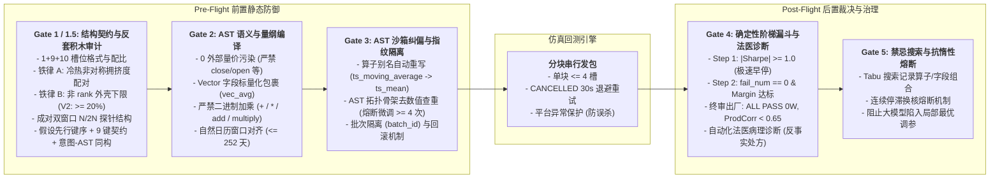
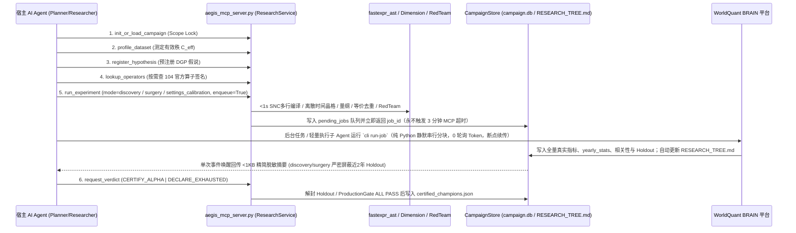

# AEGIS V3.1 工业级白盒量化多 Agent 研发架构

本项目是一套专为大规模金融量化特征工程与 Alpha 因子研发打造的**工业级白盒多 Agent 自主协同研发系统**。

系统彻底破除了传统量化 Agent 中常见的**“Prompt 沉重驱动”、“单 Agent 算子死套死比率”、“缺乏实证检验盲目调参”、“回测并发超限误杀假说”**等核心痛点，基于**数据生成过程 (Data Generating Process, DGP) 第一性原理**、**1+9+10 假说实证解耦契约**与**五重工业级工程防御门禁**，构建了真正基于数据集内生业务机理与高稳健工程防御的端到端量化研究流水线。

---

## 一、 核心哲学：Python + AI 协同范式

系统严格遵循**“规则归 Python，思考归 AI”**的高能效工业级分工：

| 维度 | 传统 Prompt 沉重流派 (已证伪) | AEGIS V3.1 架构范式 (本项目实现) |
| :--- | :--- | :--- |
| **总控载体** | LLM 充当调度总管，单会话上下文无限累加，Token 暴涨与逻辑漂移 | **纯 Python 宿主状态机 (`main.py`)**，单步会话物理隔离，0 冗余 Token |
| **假说构建** | 套用固定死模板或死分类，把算子机械嵌套在单一死比率上 | **DGP 第一性原理研读**，从字段物理画像与商业机理自然涌现因果假说 |
| **实证检验** | 尚未验证信号有无，盲目进行算子参数网格微调 | **1+9+10 实证解耦契约**：Step 1 极简实证初筛；Step 2 锁定达标母本靶向工程精修 |
| **失败惩罚** | 唤醒大模型撰写千字《失败检讨书》，消耗海量算力与 Token | **0 Token 极速早停**：Python 检测到未达标瞬间置 `times = times + 1`，0.05 秒无缝切入下一主信号 |
| **仿真并发** | 大批次无节制发包触发平台并发超限，误当 Sharpe=0 剪枝 | **分块串行发包 ($\le 4$ 槽)**，CANCELLED 退避 30s 自动重试，平台异常保护防误杀 |
| **去重与重入** | 静态原式 MD5 查重，或回测前污染指纹库导致断点恢复自锁 | **AST 拓扑骨架去数值查重** + **批次隔离 (`batch_id`)** + **未完成批次自动回滚** |
| **算子预算** | 全周期一刀切固定算子上限，导致早期过度拟合、后期无法治愈 | **动态算子预算**：初筛阶段 $\le 6$ 算子保证纯粹性，准冠军精修阶段放宽至 $\le 10$ 算子 |
| **经验沉淀** | 固化绑定具体数据字段名的死板规则，无法跨数据集迁移 | **纯算子拓扑抽象**，严禁提及具体字段名，增量追加至四级金字塔与 LanceDB 向量库 |

---

## 二、 全流程工作流与状态机 DAG

```mermaid
flowchart TD
    subgraph Stage0["阶段 0: DGP 第一性原理主信号池 (Seed Reservoir)"]
        F1["加载目标数据集字段元数据画像<br/>(名称, 描述, 频率, 覆盖率, 偏态, 拥挤度)"] --> F2["01_field_explorer 研读业务内涵<br/>02_main_signal_synthesizer 构建因果假说"]
        F2 --> F3["生成纯代数原型 (subtract / divide / ts_regression)<br/>+ Vector 标量化包裹 (vec_avg 等)"]
        F3 --> F4["03_tech_auditor 静态断言审查<br/>(0 幻觉, 0 跨界污染, 严禁二进制加乘, 日历周期对齐)"]
        F4 --> F5["写入 total_signals.json (初始 times: 0)"]
    end

    subgraph Stage1_Step1["阶段 1 - Step 1: 1+9 极简实证初筛 (Empirical Validation)"]
        F5 --> Loop["Python 状态机轮询未探索主信号 (times == 0)"]
        Loop --> Swarm1["04_swarm_generator 构建 1+9 槽实证探针:<br/>- 槽位 1: 原始母本基线<br/>- 槽位 2~10: 9 组轻量结构变体<br/>- 铁律 A: 非对称冷热拥挤度配对<br/>- 铁律 B: 保留截面残差幅度 (非 rank 外壳 >= 80%)<br/>- 双窗口成对探针 (N / 2N 参数高原验证)"]
        Swarm1 --> PreFlight1["Pre-Flight 门禁流水线:<br/>Gate 1: 卡槽结构与铁律合规<br/>Gate 2: AST 量纲守恒与 0 外部量价污染<br/>Gate 3: 本地 AST 别名纠偏 + 批次隔离防重"]
        PreFlight1 --> Sim1["量化集群分块并发回测 (单批 <= 4 槽)<br/>CANCELLED 状态 30s 退避自动重试"]
        Sim1 --> Funnel1{"Gate 4: Step 1 极速漏斗<br/>存在 |Sharpe| >= 1.0 ?"}
        Funnel1 -- "否 (无统计显著性)" --> Prune["【0 Token 极速早停】<br/>Python 直接置 times = times + 1<br/>0.05 秒无缝切换下一个主信号，严禁调用 LLM 写总结！"]
        Prune --> Loop
    end

    subgraph Stage1_Step2["阶段 1 - Step 2+: 靶向量化因子工程精修 (Factor Engineering)"]
        Funnel1 -- "是 (捕获有效信号)" --> Forensics["Gatekeeper 自动化病灶法医诊断:<br/>- 确诊: cw_bottleneck, turnover_overflow,<br/>  sub_universe_instability, prod_corr_overflow<br/>- 生成反事实处方线索与治愈建议"]
        Forensics --> Swarm2["04_swarm_generator 执行 10 槽精修:<br/>- 50% Exploit (对症施策: trade_when, ts_decay, winsorize)<br/>- 50% Explore (同源冷字段平替, 特质残差剥离)"]
        Swarm2 --> PreFlight2["Pre-Flight 门禁核验 (Gate 1~3)"]
        PreFlight2 --> Sim2["量化集群静默回测执行"]
        Sim2 --> Step2Gate{"Gate 4: Step 2 达标 ?<br/>fail_num == 0 & Margin 达标<br/>且累计优质候选 >= 3 个 ?"}
    end

    subgraph Stage1_Func2["阶段 1 - func2: 深水区精炼攻坚 (Deep Refinement)"]
        Step2Gate -- "是" --> Func2["激活 05_deep_refinement (func2)<br/>全面解锁数据集全量字段空间:<br/>1. 同源冷门字段交叉替换 (alpha_count 后 40%)<br/>2. 算子精细平替与形态保留<br/>3. 冗余节点剪枝 (压缩 AST 深度至 4~6 层)"]
        Step2Gate -- "否" --> Loop
        Func2 --> SubGate{"Gate 4: 终极出厂门禁 (ALL PASS 0W)<br/>Sharpe >= 1.58, Fitness >= 1.0<br/>Margin 达标, Turnover 5%~50%<br/>ProdCorr < 0.65 & SelfCorr <= 0.60"}
    end

    subgraph Stage2_Distill["阶段 2: 经验沉淀与 RAG 飞轮 (Knowledge Flywheel)"]
        SubGate -- "通过" --> Champion["更新 One-Champion-Per-Anchor 生产冠军榜<br/>(落地 campaign_champions.json)"]
        Champion --> Distiller["06_knowledge_distiller 纯算子经验抽象<br/>【严格准则】: 纯算子拓扑，绝不提及任何具体字段名<br/>- 增量写入 alpha_experience/{REGION}_{DELAY}_{CAT}.md<br/>- LanceDB 向量库半衰期衰减与索引更新"]
    end
```



---

## 三、 五重工业级工程防御门禁体系 (Five-Gate Defense Pipeline)

系统在回测发包前（Pre-Flight）与回测返回后（Post-Flight）构筑了严密的五道物理级确定性门禁：



### Gate 1.5: 反套积木契约审计（回测发包唯一咽喉点）

无论批次来自主状态机自动生成、func2 深水区精炼，还是研究员 `--run-batch` 手工投递，**100% 经过同一套契约审计**（`SimBatchRunner.verify_state_token_and_gates`）：

| 阶段 | 开关 | 行为 |
|---|---|---|
| **Phase A（默认）** | `AEGIS_GATE15_STRICT` 未设置或为 0 | 仅观测：审计报告落盘 `*_swarm_audit.json`，6 键存量批次零改动可跑 |
| **Phase B（生产推荐）** | `AEGIS_GATE15_STRICT=1` | 硬熔断：要求 9 键契约（`optimize_reason → hypothesis_ref → mechanism_intents → economic_delta` 先于 `expression`）；假设先行违规、意图-AST 不同构、骨架脱节直接拒绝发包 |

**生产战役 SOP**：迁移期用 Phase A 观测并补全 9 键（可用 `SwarmAuditor.upgrade_6key_to_9key()` 无损迁移）；正式生产请设置 `AEGIS_GATE15_STRICT=1`，避免契约退化为建议。

---

## 四、 核心量化研究范式与铁律

针对大模型在量化研究中极易退化为“机械调参计算器”的问题，系统确立了以下核心量化研究范式：

### 1. DGP (数据生成过程) 第一性原理研读
- **杜绝死模板**：不在提示词或代码中预先圈定“固定六大维度”或死分类，让因果假说从底层微观机制自然涌现；
- **全维度字段物理画像驱动**：向 Agent 呈送包含业务内涵描述、更新频率（低频财报 vs 高频舆情）、覆盖率截面、数据类型与偏态分布的完整画像；
- **纯代数种子原型**：Stage 0 阶段仅允许构建基础纯代数结构（`subtract`, `divide`, `ts_regression`），严禁提前引入时序与截面算子焊死参数。

### 2. 1+9+10 假说实证解耦契约
- **Step 1 极简实证初筛 (1+9 槽)**：
  * **槽位 1**：原始母本基线；
  * **槽位 2~10**：9 组极简结构实证探针（外层算子 $\le 3$，严禁提前套用 `winsorize`、`s_log_1p`、`signed_power` 等治愈算子）；
  * **0 Token 极速早停**：若 10 槽均未出现 $|\text{Sharpe}| \ge 1.0$，Python 瞬间标记 `times = times + 1`，0.05 秒切换下一个主信号，绝不浪费算力撰写失败报告。
- **Step 2+ 靶向工程精修 (10 槽)**：
  * 仅对 Step 1 实证显著（$|\text{Sharpe}| \ge 1.0$）的母本启动因子工程；
  * **50% Exploit (对症治疗)**：根据 Gatekeeper 法医诊断报告，针对性挂载 `trade_when`（治理换手）、`ts_decay`（平滑衰减）、`winsorize`（极值抑制）等处方；
  * **50% Explore (机理拓展)**：探索同源冷门字段平替与特质残差剥离。

### 3. 两大核心量化铁律
- **铁律 A：非对称冷热拥挤度配对 (Asymmetric Crowding Pairing)**
  * 主锚字段（Primary Anchor）必须选用**低拥挤度（`alpha_count` 处于后 40%）**的同源特征；
  * 归一化字段（Normalization Anchor）选用**高覆盖率、平台高共识（`alpha_count` 前 30%）**的基准特征；
  * 从根源打破模型同质化，将出厂平台相关性从 0.85+ 压降至 0.65 以下。
- **铁律 B：截面残差幅度保留 (Cardinal Magnitude Retention)**
  * **非 rank 外壳占比 $\ge 80\%$**：除必要对比槽外，优先使用 `group_neutralize` 或 `group_zscore`，坚决避免 `group_rank` 拍平极端尾部幅度，确保单笔利润厚度（Margin bps）；
  * **双窗口参数高原测试 (Paired Horizon Probe N/2N)**：变体必须成对引入基准周期 $N$ 与双倍周期 $2N$（如 20d vs 63d），通过敏感性比对排查尖峰过拟合，唯有处于“参数高原”的特征才获准晋级。

### 4. 动态算子预算机制
- **探索与初筛阶段**：全局算子数硬性约束在 $\le 6$，强制 Agent 聚焦于最纯粹的经济学主逻辑；
- **准冠军定向深化阶段**：当且仅当研究员指定已有达标母本（`--alpha-id`）或晋级 `func2` 深水区时，算子预算才放宽至 $\le 10$，允许挂载精细风控与状态冻结外壳。

---

## 五、 AEGIS V4.1 宿主驱动交互协议 (Host-Driven MCP & FastExpr Compiler)

V4.1 彻底废除了旧版 `.agent_tasks/` 邮箱轮询与 `Exit Code 20` 挂起协议，由顶级宿主 Agent 通过 **`aegis_mcp_server.py`** 直接调用 7 个确定性状态机工具完成科研闭环：



### 核心建筑不变量：
1. **104 Official Operators SSOT**：唯一真源来自 `knowledge_base/operators/user_operators.json`（含 `lookup_operators` 按需查询与 < 1KB 极简索引），物理清理 `exp`/`jump_decay`/`ts_max`/`ts_min`/`ts_skewness`/`ts_kurtosis`/`pasteurize`/`group_quantile`/`neg` 等幻觉算子；
2. **SNC 多行编译器 & 离散晶格 (`core/fastexpr_ast.py`)**：以 `mode='exec'` 统一替代全仓旧版 `mode='eval'`，算子数 $\ge 4$ 强制多行 SNC 拆解（$\ge 2$ 条赋值且每行 $\le 3$ 非 `vec_*` 算子）与变量后缀同构，并强制日/月/季离散时间窗口与参数晶格 (`winsorize std ∈ {3,4}`, `power ∈ {0.25, 0.5, 1.0, 1.5, 2.0}`)；
3. **三文件极简收敛与零碎片卫生**：每个 V4.1 战役目录仅允许包含 `campaign.db`（含 `pending_jobs` 持久化作业队列表）、`RESEARCH_TREE.md`（自动生成只读）与 `certified_champions.json`（+ 可选 `artifacts/`），严禁落盘 `.py` 临时脚本与 `.agent_tasks/` 碎片；
4. **大脑/四肢解耦（0 MCP 超时 / 0 轮询算力浪费 / <1KB 摘要）**：主 Agent 通过 `enqueue=True` 1 秒内过门禁入队，再通过后台任务或轻量执行子 Agent 跑官方内置命令 `python3 aegis_mcp_server.py cli run-job --campaign <id> --job <job_id>` 静默完成 6–15 分钟长回测，支持断点续传并仅回传 `<1KB` 脱敏关键摘要，彻底隔绝 `brain-mcp` 原始大 JSON 污染上下文；
5. **$C_{\text{eff}}$ 科学穷尽裁决**：禁止主观宣布数据集饱和；仅当 `orthogonal_hypotheses`、机制家族多样性、不重样核心骨架实验数、字段语义簇覆盖率 $\ge 80\%$ 与未决线索清零均通过 `C_eff` 动态门槛时方允许退出。

---

## 六、 架构核心资产清单与目录索引

```
quant_framework/
├── aegis_mcp_server.py         # [V4.1] FastMCP 7-Tool 宿主服务引擎与 CLI 工具入口
├── main.py                     # Legacy 状态机调度入口（已全面对齐 parse_fastexpr / Fail-Closed）
├── orchestrator.py             # 研发总控命令行兼容桥接接口
│
├── core/                       # 核心底层规则引擎与治理体系
│   ├── research_service.py     # [V4.1] 有状态量化研究服务层 (Scope Lock, C_eff, Holdout Masking)
│   ├── campaign_store.py       # [V4.1] 三文件收敛存储 (campaign.db, RESEARCH_TREE.md, certified_champions.json)
│   ├── fastexpr_ast.py         # [V4.1] 统一 FastExpr AST 编译器、SNC、离散时间晶格与双向消融构造器
│   ├── production_gate.py      # 统一生产资格唯一发证门禁 (ALL PASS 0 FAIL + 0 缺陷 WARNING)
│   ├── sim_runner.py           # 仿真回测执行器 (适配 create_multi_simulation 协议与双重差分消融)
│   ├── func_call_corrector.py  # Gate 3: 本地 AST 纠偏、26类壳算子剥离、跨批骨架防摸鱼拦截
│   ├── gatekeeper.py           # Gate 4: 缺陷/信息 WARNING 分离、内部 Holdout 隔离与法医处方路由
│   ├── dimension_rules.py      # Gate 2: AST SNC 变量传播、跨量纲除法与 0 PV 污染拦截器
│   ├── anti_laziness.py        # Gate 5: Tabu 水位线与 C_eff 四维数据集穷尽裁决器
│   ├── swarm_auditor.py        # Gate 1.5: 1+9+10 契约、5/9 键兼容与窗口微调 10% 上限检查器
│   ├── crowding_pairing.py     # 铁律 A: 主锚与归一化锚冷热配对与跨量纲禁区过滤
│   ├── horizon_probe.py        # 双窗口参数高原探针 (含 fail_closed 母本严格过滤)
│   ├── operator_registry.py    # 104 官方算子单一事实源 (SSOT) 与按需查询接口
│   ├── rag_memory.py           # 四级金字塔经验引擎 (自动过滤劝退/换数据集噪音)
│   ├── field_resolver.py       # 字段画像解析与脏跨数据集字段物理过滤
│   ├── agent_backends.py       # 多后端适配层 (默认 0ms Fail-Fast，废除 .agent_tasks 轮询)
│   ├── qa_rag_tool.py          # 原子化 QA 卡片检索工具
│   └── red_team.py             # 双盲红队与语义保留安慰剂对照构造器
│
├── roles/                      # 研究员角色规范提示词 (Prompts)
│   ├── 01_field_explorer.md    # 字段认知与业务画像沉淀
│   ├── 02_main_signal_synthesizer.md # Stage 0: DGP 第一性原理假说与 SNC/晶格约束
│   ├── 03_tech_auditor.md      # Stage 0: AST SNC/104 SSOT/量纲技术静态断言
│   ├── 04_swarm_generator.md   # Stage 1: 弹性并发、5/9键契约与 Settings-Last
│   ├── 05_deep_refinement.md   # Stage 1: 深水区精炼与 0 缺陷 WARNING 终审口径
│   └── 06_knowledge_distiller.md # Stage 2: 蓝标冠军经验提炼 (ProdCorr < 0.65)
│
├── .agents/                    # 宿主环境 Agent 角色索引与定义
├── knowledge_base/             # 先验领域知识库 (104 SSOT operators, fields, cards, dataset_postmortems)
├── alpha_experience/           # 通用纯算子因果经验手册
└── tests/                      # 自动化回归与 V4.1 架构不变量验证套件
```

> [!NOTE]
> **三文件战役工作区规范**：
> 每个 V4.1 研究战役在 `campaigns/<campaign_id>/` 下仅保留 `campaign.db`、`RESEARCH_TREE.md` 与 `certified_champions.json`（可选 `artifacts/`）。严禁在运行目录下创建 `.agent_tasks/` 或游离 `.py` 脚本。

---

## 七、 快速启动与常用命令

### 1. 验证环境与运行全量回归测试套件
```bash
# 运行全部单元测试套件
python3 -m unittest discover -s tests -p "test_*.py"

# 验证端到端流水线
python3 tests/test_pipeline_e2e.py

# 通过 CLI 查询 104 授权算子签名
python3 aegis_mcp_server.py cli operators --query decay

# 启动 Host-Driven MCP Server (供宿主 AI Agent 挂载)
python3 aegis_mcp_server.py
```

### 2. V4.1 双启动工作流 (经由 MCP 宿主工具闭环)

- **情景一：从零挖掘新数据集 (Mode A - Greenfield Discovery)**
  1. `init_or_load_campaign(region, universe, dataset_id, delay=1, category=...)`
  2. `profile_dataset(campaign_id)` 计算特征有效秩 $C_{\text{eff}}$ 并查看字段角色分布
  3. `register_hypothesis(...)` 预注册 DGP 因果假说，配合 `lookup_operators(...)` 查询精确签名
  4. `run_experiment(..., mode="discovery")` 以 SNC 多行写法与离散晶格并发检验 1~20 条探索分支
  5. 当出现 `|Sharpe| >= 1.25` 苗子后转入 `mode="surgery"`（1~8 条）与 `mode="settings_calibration"`（1~4 条）
  6. 达标后调用 `request_verdict(action="CERTIFY_ALPHA")` 解封 Holdout 并写入 `certified_champions.json`；确需结案时必须经 `request_verdict(action="DECLARE_EXHAUSTED")` 审核。

- **情景二：针对已有 `alpha_id` 定向攻坚 (Mode B - Targeted Optimization)**
  1. `init_or_load_campaign(..., seed_alpha_id="ALPHA_ID", seed_profile={...})` 锁定母本基线与 Scope Lock
  2. 直接基于母本病灶注册靶向改良假说并按 `run_experiment(mode="surgery")` → `settings_calibration` → `CERTIFY_ALPHA` 闭环推进至 ALL PASS (`0 FAIL + 0 缺陷 WARNING`, `ProdCorr < 0.65`)。
