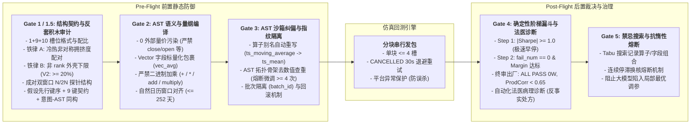
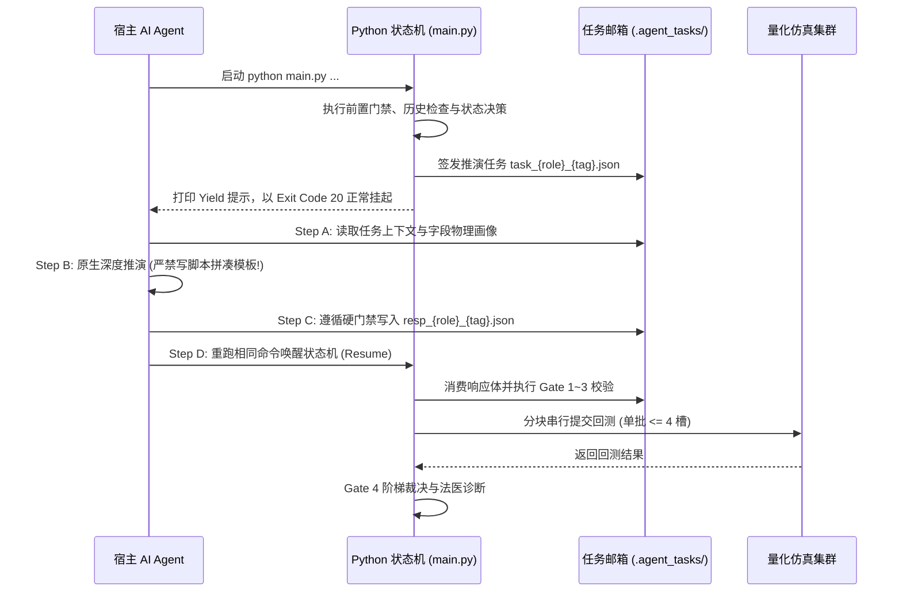

# AEGIS V3.1 工业级白盒量化多 Agent 研发架构

本项目是一套专为大规模金融量化特征工程与 Alpha 因子研发打造的**工业级白盒多 Agent 自主协同研发系统**。

系统彻底破除了传统量化 Agent 中常见的**“Prompt 沉重驱动”、“单 Agent 算子死套死比率”、“缺乏实证检验盲目调参”、“回测并发超限误杀假说”**等核心痛点，基于**数据生成过程 (Data Generating Process, DGP) 第一性原理**、**1+9+10 假说实证解耦契约**与**五重工业级工程防御门禁**，构建了真正基于数据集内生业务机理与高稳健工程防御的端到端量化研究流水线。

---

## 一、 核心哲学：Python + AI 协同范式

系统严格遵循**“规则归 Python，思考归 AI”**的高能效工业级分工：

| 维度 | 传统 Prompt 沉重流派 (已证伪) | AEGIS V3.1 架构范式 (本项目实现) |
| :--- | :--- | :--- |
| **总控载体** | LLM 充当调度总管，单会话上下文无限累加，Token 暴涨与逻辑漂移 | **纯 Python 宿主状态机 (`main.py`)**，单步会话物理隔离，0 冗余 Token |
| **假说构建** | 套用固定死模板或死分类，把算子机械嵌套在单一死比率上 | **DGP 第一性原理研读**，从字段物理画像与商业机理自然涌现因果假说 |
| **实证检验** | 尚未验证信号有无，盲目进行算子参数网格微调 | **1+9+10 实证解耦契约**：Step 1 极简实证初筛；Step 2 锁定达标母本靶向工程精修 |
| **失败惩罚** | 唤醒大模型撰写千字《失败检讨书》，消耗海量算力与 Token | **0 Token 极速早停**：Python 检测到未达标瞬间置 `times = times + 1`，0.05 秒无缝切入下一主信号 |
| **仿真并发** | 大批次无节制发包触发平台并发超限，误当 Sharpe=0 剪枝 | **分块串行发包 ($\le 4$ 槽)**，CANCELLED 退避 30s 自动重试，平台异常保护防误杀 |
| **去重与重入** | 静态原式 MD5 查重，或回测前污染指纹库导致断点恢复自锁 | **AST 拓扑骨架去数值查重** + **批次隔离 (`batch_id`)** + **未完成批次自动回滚** |
| **算子预算** | 全周期一刀切固定算子上限，导致早期过度拟合、后期无法治愈 | **动态算子预算**：初筛阶段 $\le 6$ 算子保证纯粹性，准冠军精修阶段放宽至 $\le 10$ 算子 |
| **经验沉淀** | 固化绑定具体数据字段名的死板规则，无法跨数据集迁移 | **纯算子拓扑抽象**，严禁提及具体字段名，增量追加至四级金字塔与 LanceDB 向量库 |

---

## 二、 全流程工作流与状态机 DAG

```mermaid
flowchart TD
    subgraph Stage0["阶段 0: DGP 第一性原理主信号池 (Seed Reservoir)"]
        F1["加载目标数据集字段元数据画像<br/>(名称, 描述, 频率, 覆盖率, 偏态, 拥挤度)"] --> F2["01_field_explorer 研读业务内涵<br/>02_main_signal_synthesizer 构建因果假说"]
        F2 --> F3["生成纯代数原型 (subtract / divide / ts_regression)<br/>+ Vector 标量化包裹 (vec_avg 等)"]
        F3 --> F4["03_tech_auditor 静态断言审查<br/>(0 幻觉, 0 跨界污染, 严禁二进制加乘, 日历周期对齐)"]
        F4 --> F5["写入 total_signals.json (初始 times: 0)"]
    end

    subgraph Stage1_Step1["阶段 1 - Step 1: 1+9 极简实证初筛 (Empirical Validation)"]
        F5 --> Loop["Python 状态机轮询未探索主信号 (times == 0)"]
        Loop --> Swarm1["04_swarm_generator 构建 1+9 槽实证探针:<br/>- 槽位 1: 原始母本基线<br/>- 槽位 2~10: 9 组轻量结构变体<br/>- 铁律 A: 非对称冷热拥挤度配对<br/>- 铁律 B: 保留截面残差幅度 (非 rank 外壳 >= 80%)<br/>- 双窗口成对探针 (N / 2N 参数高原验证)"]
        Swarm1 --> PreFlight1["Pre-Flight 门禁流水线:<br/>Gate 1: 卡槽结构与铁律合规<br/>Gate 2: AST 量纲守恒与 0 外部量价污染<br/>Gate 3: 本地 AST 别名纠偏 + 批次隔离防重"]
        PreFlight1 --> Sim1["量化集群分块并发回测 (单批 <= 4 槽)<br/>CANCELLED 状态 30s 退避自动重试"]
        Sim1 --> Funnel1{"Gate 4: Step 1 极速漏斗<br/>存在 |Sharpe| >= 1.0 ?"}
        Funnel1 -- "否 (无统计显著性)" --> Prune["【0 Token 极速早停】<br/>Python 直接置 times = times + 1<br/>0.05 秒无缝切换下一个主信号，严禁调用 LLM 写总结！"]
        Prune --> Loop
    end

    subgraph Stage1_Step2["阶段 1 - Step 2+: 靶向量化因子工程精修 (Factor Engineering)"]
        Funnel1 -- "是 (捕获有效信号)" --> Forensics["Gatekeeper 自动化病灶法医诊断:<br/>- 确诊: cw_bottleneck, turnover_overflow,<br/>  sub_universe_instability, prod_corr_overflow<br/>- 生成反事实处方线索与治愈建议"]
        Forensics --> Swarm2["04_swarm_generator 执行 10 槽精修:<br/>- 50% Exploit (对症施策: trade_when, ts_decay, winsorize)<br/>- 50% Explore (同源冷字段平替, 特质残差剥离)"]
        Swarm2 --> PreFlight2["Pre-Flight 门禁核验 (Gate 1~3)"]
        PreFlight2 --> Sim2["量化集群静默回测执行"]
        Sim2 --> Step2Gate{"Gate 4: Step 2 达标 ?<br/>fail_num == 0 & Margin 达标<br/>且累计优质候选 >= 3 个 ?"}
    end

    subgraph Stage1_Func2["阶段 1 - func2: 深水区精炼攻坚 (Deep Refinement)"]
        Step2Gate -- "是" --> Func2["激活 05_deep_refinement (func2)<br/>全面解锁数据集全量字段空间:<br/>1. 同源冷门字段交叉替换 (alpha_count 后 40%)<br/>2. 算子精细平替与形态保留<br/>3. 冗余节点剪枝 (压缩 AST 深度至 4~6 层)"]
        Step2Gate -- "否" --> Loop
        Func2 --> SubGate{"Gate 4: 终极出厂门禁 (ALL PASS 0W)<br/>Sharpe >= 1.58, Fitness >= 1.0<br/>Margin 达标, Turnover 5%~50%<br/>ProdCorr < 0.65 & SelfCorr <= 0.60"}
    end

    subgraph Stage2_Distill["阶段 2: 经验沉淀与 RAG 飞轮 (Knowledge Flywheel)"]
        SubGate -- "通过" --> Champion["更新 One-Champion-Per-Anchor 生产冠军榜<br/>(落地 campaign_champions.json)"]
        Champion --> Distiller["06_knowledge_distiller 纯算子经验抽象<br/>【严格准则】: 纯算子拓扑，绝不提及任何具体字段名<br/>- 增量写入 alpha_experience/{REGION}_{DELAY}_{CAT}.md<br/>- LanceDB 向量库半衰期衰减与索引更新"]
    end
```



---

## 三、 五重工业级工程防御门禁体系 (Five-Gate Defense Pipeline)

系统在回测发包前（Pre-Flight）与回测返回后（Post-Flight）构筑了严密的五道物理级确定性门禁：



### Gate 1.5: 反套积木契约审计（回测发包唯一咽喉点）

无论批次来自主状态机自动生成、func2 深水区精炼，还是研究员 `--run-batch` 手工投递，**100% 经过同一套契约审计**（`SimBatchRunner.verify_state_token_and_gates`）：

| 阶段 | 开关 | 行为 |
|---|---|---|
| **Phase A（默认）** | `AEGIS_GATE15_STRICT` 未设置或为 0 | 仅观测：审计报告落盘 `*_swarm_audit.json`，6 键存量批次零改动可跑 |
| **Phase B（生产推荐）** | `AEGIS_GATE15_STRICT=1` | 硬熔断：要求 9 键契约（`optimize_reason → hypothesis_ref → mechanism_intents → economic_delta` 先于 `expression`）；假设先行违规、意图-AST 不同构、骨架脱节直接拒绝发包 |

**生产战役 SOP**：迁移期用 Phase A 观测并补全 9 键（可用 `SwarmAuditor.upgrade_6key_to_9key()` 无损迁移）；正式生产请设置 `AEGIS_GATE15_STRICT=1`，避免契约退化为建议。

---

## 四、 核心量化研究范式与铁律

针对大模型在量化研究中极易退化为“机械调参计算器”的问题，系统确立了以下核心量化研究范式：

### 1. DGP (数据生成过程) 第一性原理研读
- **杜绝死模板**：不在提示词或代码中预先圈定“固定六大维度”或死分类，让因果假说从底层微观机制自然涌现；
- **全维度字段物理画像驱动**：向 Agent 呈送包含业务内涵描述、更新频率（低频财报 vs 高频舆情）、覆盖率截面、数据类型与偏态分布的完整画像；
- **纯代数种子原型**：Stage 0 阶段仅允许构建基础纯代数结构（`subtract`, `divide`, `ts_regression`），严禁提前引入时序与截面算子焊死参数。

### 2. 1+9+10 假说实证解耦契约
- **Step 1 极简实证初筛 (1+9 槽)**：
  * **槽位 1**：原始母本基线；
  * **槽位 2~10**：9 组极简结构实证探针（外层算子 $\le 3$，严禁提前套用 `winsorize`、`s_log_1p`、`signed_power` 等治愈算子）；
  * **0 Token 极速早停**：若 10 槽均未出现 $|\text{Sharpe}| \ge 1.0$，Python 瞬间标记 `times = times + 1`，0.05 秒切换下一个主信号，绝不浪费算力撰写失败报告。
- **Step 2+ 靶向工程精修 (10 槽)**：
  * 仅对 Step 1 实证显著（$|\text{Sharpe}| \ge 1.0$）的母本启动因子工程；
  * **50% Exploit (对症治疗)**：根据 Gatekeeper 法医诊断报告，针对性挂载 `trade_when`（治理换手）、`ts_decay`（平滑衰减）、`winsorize`（极值抑制）等处方；
  * **50% Explore (机理拓展)**：探索同源冷门字段平替与特质残差剥离。

### 3. 两大核心量化铁律
- **铁律 A：非对称冷热拥挤度配对 (Asymmetric Crowding Pairing)**
  * 主锚字段（Primary Anchor）必须选用**低拥挤度（`alpha_count` 处于后 40%）**的同源特征；
  * 归一化字段（Normalization Anchor）选用**高覆盖率、平台高共识（`alpha_count` 前 30%）**的基准特征；
  * 从根源打破模型同质化，将出厂平台相关性从 0.85+ 压降至 0.65 以下。
- **铁律 B：截面残差幅度保留 (Cardinal Magnitude Retention)**
  * **非 rank 外壳占比 $\ge 80\%$**：除必要对比槽外，优先使用 `group_neutralize` 或 `group_zscore`，坚决避免 `group_rank` 拍平极端尾部幅度，确保单笔利润厚度（Margin bps）；
  * **双窗口参数高原测试 (Paired Horizon Probe N/2N)**：变体必须成对引入基准周期 $N$ 与双倍周期 $2N$（如 20d vs 63d），通过敏感性比对排查尖峰过拟合，唯有处于“参数高原”的特征才获准晋级。

### 4. 动态算子预算机制
- **探索与初筛阶段**：全局算子数硬性约束在 $\le 6$，强制 Agent 聚焦于最纯粹的经济学主逻辑；
- **准冠军定向深化阶段**：当且仅当研究员指定已有达标母本（`--alpha-id`）或晋级 `func2` 深水区时，算子预算才放宽至 $\le 10$，允许挂载精细风控与状态冻结外壳。

---

## 五、 宿主 Agent 挂起-恢复 (Yield & Resume) 执行协议

当在具备自主执行能力的宿主 AI 环境中作为量化研究员接管本架构并运行默认模式（`--backend builtin`）时，系统通过标准文件邮箱进行状态机无锁交互：



### 挂起-恢复关键守则：
1. **识别 Exit Code 20**：终端打印 `⏸️ 【AEGIS 状态机断点挂起 (Yield)】` 且进程退出码为 `20` 时，为**正常断点挂起**，绝非报错崩溃；
2. **原生大模型推演**：以对应角色身份，在原生大模型上下文中完成假说构建与病灶推导，**绝对禁止编写 Python 脚本通过循环拼接生成 `resp_*.json`**；
3. **重入恢复**：写入合规响应后，直接在终端执行完全相同的 `python main.py ...` 命令即可继续推进。

---

## 六、 架构核心资产清单与目录索引

```
quant_framework/
├── main.py                     # [核心] 纯 Python 状态机总控引擎 (GrandMaster V3.1 调度中心)
├── orchestrator.py             # 研发总控命令行兼容桥接接口
├── alphas_record.db            # SQLite 指纹库 (MD5、AST 骨架拓扑哈希、回测结果历史)
├── campaign_champions.json     # 生产池出厂冠军报表 (One-Champion-Per-Anchor 唯一代表)
│
├── core/                       # 核心底层规则引擎与治理体系
│   ├── sim_runner.py           # 仿真回测执行器 (串行分批 <=4 槽, 30s 退避重试, 平台异常保护)
│   ├── func_call_corrector.py  # Gate 3: 本地 AST 别名纠偏、骨架查重、批次隔离与回滚
│   ├── gatekeeper.py           # Gate 4: 确定性阶梯漏斗裁决与法医病理解剖路由器
│   ├── dimension_rules.py      # Gate 2: AST 量纲守恒、标量化与 0 PV 外部污染审查器
│   ├── anti_laziness.py        # Gate 5: Tabu 禁忌搜索与连续停滞换核熔断器
│   ├── swarm_auditor.py        # Gate 1: 1+9+10 结构契约与铁律 B (残差幅度保留) 审查器
│   ├── crowding_pairing.py     # 铁律 A: 主锚与归一化锚冷热非对称拥挤度配对器
│   ├── horizon_probe.py        # 双窗口参数高原测试分析器 (成对 N/2N 探针)
│   ├── operator_registry.py    # 算子单一事实源 (SSOT) 与动态分类预算字典
│   ├── rag_memory.py           # 四级金字塔纯算子经验库与半衰期衰减 RAG 引擎
│   ├── field_resolver.py       # 字段元数据多格式解析器与跨区域继承中枢
│   ├── agent_backends.py       # 多后端适配层 (内置 Agent Yield 邮箱, SubAgent IPC, Mock, API)
│   ├── agy_client.py           # 客户端交互与会话管理适配器
│   ├── concurrency_utils.py    # 跨平台原子化 I/O 与并发文件锁基础设施
│   ├── qa_rag_tool.py          # 主脑原子化 QA 经验卡片检索工具
│   └── red_team.py             # 双盲红队脱敏签名与隔离验证机制
│
├── roles/                      # 研究员角色规范提示词 (Prompts)
│   ├── 01_field_explorer.md    # 字段认知与业务画像沉淀
│   ├── 02_main_signal_synthesizer.md # 阶段 0: DGP 第一性原理主信号因果假说构建专家
│   ├── 03_tech_auditor.md      # 阶段 0: 技术内容静态断言审核专家 (拦截 PV 与加乘违规)
│   ├── 04_swarm_generator.md   # 阶段 1: 1+9+10 实证解耦与群体发散专家 (func1)
│   ├── 05_deep_refinement.md   # 阶段 1: 深水区精炼与全量冷字段平替专家 (func2)
│   └── 06_knowledge_distiller.md # 阶段 2: 纯算子去字段化经验提炼专家 (func3)
│
├── .agents/                    # 宿主环境 Native Agent 角色注册配置
│   ├── agents.json             # Agent 注册索引
│   └── agents/                 # 各角色独立 Agent 规范定义文档
│
├── knowledge_base/             # 先验领域知识库与治理资产
│   ├── fields/                 # 全球各市场各数据集字段物理画像字典 ({REGION}/{dataset_id}.json)
│   ├── cards/                  # 历史高价值量化法医诊断与治理处方卡片 (CARD_*.json)
│   ├── operators/              # 官方授权可用算子目录与使用规范
│   ├── references/             # 量化研究方法论 (8问因果框架、单因子决策树、算子指引)
│   ├── lancedb_manager.py      # LanceDB 向量数据库管理模块
│   └── falsified_vault.json    # 证伪假说与暗坑模式负向知识库
│
├── alpha_experience/           # 四级金字塔纯算子经验库 ({REGION}_{DELAY}_{CATEGORY}.md)
│   ├── USA_1_news.md           # 纯算子拓扑、时序算子组合与病灶处方经验
│   ├── USA_1_other.md          # 另类数据纯算子拓扑实战沉淀
│   └── GLB_1_fundamental.md    # 基本面数据纯算子拓扑沉淀
│
└── tests/                      # 工业级自动化单元与回归测试套件 (15 套测试，100% 通过)
    ├── test_v31_refactor.py    # V3.1 核心状态机重构与 1+9+10 契约验证
    ├── test_crowding_horizon_ironlaw.py # 铁律 A (冷热配对) 与铁律 B (残差幅度) 验证
    ├── test_prompt_guardrail_alignment.py # 角色提示词与底层硬门禁对齐测试
    ├── test_operator_phase_constraints.py # 阶段算子预算动态约束测试
    ├── test_grandmaster_e2e.py # 端到端调度总控回归测试
    ├── test_hardness_e2e.py    # 工业级鲁棒性与异常保护测试
    ├── test_pipeline_e2e.py    # 完整研发流水线实践验证
    └── fixtures/               # 测试固件与 Mock 数据
```

> [!NOTE]
> **非架构本体的临时产物与运行态数据**：
> - `campaigns/`：各次挖掘活动（Campaign）产生的运行态过程文件（批次回测记录、临时中间件等）；
> - `.agent_tasks/`：Yield & Resume 协议在运行时用于交换任务与响应的临时 IPC 邮箱；
> - `tmp/` 与 `__pycache__/`：系统运行时生成的临时文件与 Python 字节码缓存。

---

## 七、 快速启动与常用命令

### 1. 运行工业级全量回归测试套件
```powershell
# 运行全部 15 套测试用例 (全绿通过，验证五重门禁与状态机完备性)
python -m unittest discover -s tests -p "test_*.py"
```

### 2. 典型量化挖掘工作流 (分步执行)

```powershell
# =========================================================================
# 步骤 1: 仅运行 Stage 0 字段深度研读并生成主信号种子池
# 【说明】: 带 --generate-seeds 运行为主信号生成模式，
# 仅执行 Stage 0 生成 total_signals.json 后进程平稳退出，不进入 Stage 1。
# =========================================================================
python main.py --region USA --universe TOP1000 --category news --dataset news12 --generate-seeds

# =========================================================================
# 步骤 2: 启动 Stage 1 状态机主循环 (不要带 --generate-seeds)
# 自动轮询 total_signals.json 中未探索的种子 (times == 0)，
# 严格执行 Step 1 假说初筛与 Step 2 靶向因子工程精修。
# =========================================================================
python main.py --region USA --universe TOP1000 --category news --dataset news12 --delay 1 --parallelism 20
```

### 3. 定向深化模式 (Targeted Warm-Start Mode)

```powershell
# =========================================================================
# 针对已有达标母本进行定向深化
# 【说明】: 传入 --alpha-id 时，状态机将其载入为初始母本种子，算子预算自动
# 放宽至 <= 10 算子，围绕母本展开靶向病灶精修与深水区冷字段平替。
# =========================================================================
python main.py --region USA --universe TOP1000 --category news --dataset news12 --alpha-id ALPH_XXXXX
```

### 4. 常用运行参数说明

| 参数 | 默认值 | 说明与代码级边界 |
| :--- | :--- | :--- |
| `--region` | `USA` | 目标市场区域 (`USA`, `EUR`, `ASI`, `GLB`, `IND`, `MEA` 等) |
| `--universe` | `TOP1000` | 标的股票池 (`TOP1000`, `TOP3000`, `SP500`, `MINV1M` 等) |
| `--delay` | `1` | 信号生效延迟 (`1` 或 `0`) |
| `--category` | `news` | 数据集大类 (`news`, `sentiment`, `analyst`, `fundamental`, `pv` 等) |
| `--dataset` | `news12` | 目标数据集标识符 |
| `--parallelism` | `20` | 单批群体发散变体数量 (系统会自动以 $\le 4$ 槽分块串行发包) |
| `--backend` | `builtin` | 智能体执行后端。可选 `["builtin", "subagent", "ipc", "file", "llm_api", "mock"]` |
| `--generate-seeds` | `False` | 互斥标志位：指定时仅执行 Stage 0 生成主信号池后平稳退出 |
| `--alpha-id` | `None` | 指定已有高潜 Alpha ID，进入准冠军定向深化模式 |
| `--mock-only` | `False` | 仅使用本地白盒模拟规则引擎（毫秒级响应，用于脱机测试） |
| `--no-cross-region-fields`| `False` | 禁用跨区域同源字段自动继承 |
