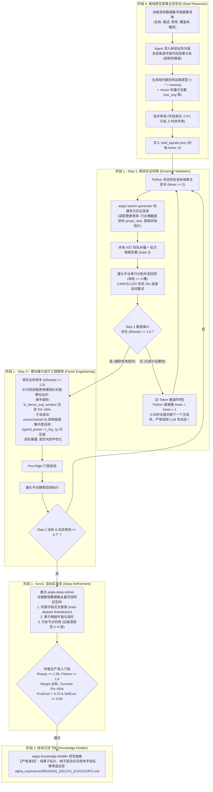

# AEGIS GrandMaster 工业级白盒量化多 Agent 研发架构

本项目是一套专为大规模金融量化特征工程与 Alpha 因子研发打造的**工业级白盒多 Agent 自主协同研发系统**。

系统彻底破除了传统量化 Agent 中常见的**“Prompt 沉重驱动”、“单 Agent 算子死套死比率”、“缺乏实证检验盲目调参”、“回测并发超限误杀假说”**等核心痛点，构建了真正基于数据集内生业务机理与工业级工程防御的端到端量化研究流水线。

---

## 一、 核心哲学：Python + AI 协同范式

系统严格遵循**“规则归 Python，思考归 AI”**的高能效工业级分工：

| 维度 | 传统 Prompt 沉重流派 (已证伪) | AEGIS GrandMaster 范式 (本项目实现) |
| :--- | :--- | :--- |
| **总控载体** | LLM 充当调度总管，单会话上下文无限累加，Token 暴涨与逻辑漂移 | **纯 Python 宿主状态机 (`main.py`)**，单步会话物理隔离，0 冗余 Token |
| **假说构建** | 套用固定死模板或死分类，把算子机械嵌套在单一死比率上 | **去模板化深度字段研读**，从字段物理画像与商业逻辑自然涌现因果假说 |
| **实证检验** | 尚未验证信号有无，盲目进行算子参数网格微调 | **两阶段分工**：Step 1 实证初筛信号真伪；Step 2 锁定达标母本靶向工程精修 |
| **失败惩罚** | 唤醒大模型撰写千字《失败检讨书》，消耗海量算力与 Token | **0 Token 极速早停**：Python 检测到未达标瞬间置 `times=1`，0.05 秒无缝切入下一主信号 |
| **仿真与并发** | 大批次无节制发包触发平台 CANCELLED，误当 Sharpe=0 剪枝 | **分块串行发包 ($\le 4$ 槽)**，CANCELLED 退避 30s 自动重试，平台异常保护防误杀 |
| **去重与重入** | 静态原式 MD5 查重，或回测前污染指纹库导致断点恢复自锁 | **AST 拓扑骨架去数值查重** + **批次隔离 (`batch_id`)** + **未完成批次自动回滚** |
| **经验沉淀** | 固化绑定具体数据字段名的死板规则，无法跨数据集迁移 | **纯算子拓扑抽象**，严禁提及具体字段名，增量追加至四级金字塔知识库 |

---

## 二、 全流程工作流与状态机 DAG



---

## 二（附）、 AI Agent 宿主接管与「挂起-恢复 (Yield & Resume)」执行协议

当你在 Cursor / Claude Code / Antigravity 等 AI 开发环境中作为宿主 Agent 接手本仓库并运行默认模式（`--backend builtin`）时，**必须严格遵守以下状态机交互协议**：

### 1. 识别 `Exit Code 20` 正常断点挂起信号
- 当你在终端运行 `python main.py ...` 后，如果终端打印：
  ```
  ⏸️ 【AEGIS 状态机断点挂起 (Yield)】已向宿主 AI Agent 签发思考任务单！
     任务路径: .agent_tasks/task_{role}_{tag}.json
  ```
  并且进程退出码为 **`20`**，**这绝不是程序崩溃或报错！**
  这是 Python 状态机到达了需要由你进行量化推演的思考节点，主动让渡控制权（Yield）。

### 2. 宿主 Agent 标准响应四步闭环 (The 4-Step Loop)
- **Step A (读任务)**：读取终端提示的 `.agent_tasks/task_{role}_{tag}.json`，获取 `system_prompt`、`prompt` 及候选字段物理画像 `context`；
- **Step B (原生深度推演，严禁写脚本批量生成！)**：以对应角色身份，在原生大模型上下文中逐条完成商业逻辑研读、字段语义映射或回测病灶诊断。**绝对禁止编写 Python 脚本通过字符串拼接或循环模板生成 `resp_*.json`！**
- **Step C (守门禁写响应)**：将严格符合 JSON Schema 的推演结果写入 `.agent_tasks/resp_{role}_{tag}.json`。必须严格遵守以下硬门禁红线：
  * **Stage 0 种子原型门禁**：简单两字段比率/差分占比 $\le 25\%$，同代数骨架 $\le 3$ 条；严禁出现任何 `ts_*` 时序算子与 `group_*` 截面算子；严禁非 PV 数据集引入外部量价字段；字段白名单存活率必须 $\ge 50\%$；
  * **Stage 1 Step 1 初筛门禁**：外层算子数 $\le 3$；严禁提前使用治愈型算子 `winsorize` / `s_log_1p` / `signed_power`（留给 Step 2 针对性精修）；
  * **Stage 1 全程硬指标**：总算子数 $\le 8$；数据集字段数 $\le 4$；单批（如 20 条）内相同 AST 算子拓扑骨架 $\le 4$ 条（$\le 20\%$，严禁参数微调网格搜索）；JSON 对象中先写 `optimize_reason` 再写 `expression`；
- **Step D (重入恢复 Resume)**：写入 `resp_*.json` 后，立即在终端**重新运行完全相同的 `python main.py ...` 命令**，状态机将自动消费该响应并推进至仿真回测与下一节点。

---

## 三、 核心研究范式：去模板化与字段内生因果推演

针对大模型在量化研究中极易退化为“机械调参计算器”的问题，系统确立了以下核心研究准则：

### 1. 严禁任何教科书式的预设分类与死板清单
- 不在提示词或代码中预先圈定“固定六大维度”或死套路；
- 金融市场数据集千差万别（涵盖基本面、分析师预期、另类情绪、期权异动、供应链等），**任何预设清单都会扼杀大模型的探索边界**。

### 2. 字段物理画像驱动的原生思考
系统向 Agent 呈送无损的真实特征元数据画像：
- **官方业务描述 (`description`)**：理解字段度量的实体商业与财务实质；
- **更新频率 (`update_frequency`)**：低频（季度财报）严禁日频短差分，优先长周期平滑或跨期差分；高频（舆情/分析师）注重动量捕获与衰减平滑；
- **覆盖率 (`coverage`)**：自动过滤低覆盖率垃圾字段，优先研究有效截面广的稳健特征；
- **数据类型与偏态 (`type`, `skewness`)**：VECTOR 必须包裹降维标量化算子，高偏态特征需前置抑制极值。

### 3. 因果假说 (`economic_mechanism`) 的实证检验闭环
- **Stage 0 假说提出**：Agent 基于字段内生逻辑推导因果机制（预期差分、规模相对归一、异质信息差、比率失衡等），用纯基础代数形成可测原型；
- **Stage 1 Step 1 实证检验**：在目标市场真实行情与股票池中验证假设是否具备统计显著性；
- **Stage 1 Step 2 工程调优**：仅对经验证确实具备超额收益的母本应用因子工程工具箱。

---

## 四、 工业级工程防御与稳定性体系

为保障在无人值守、长时间跨度或弱网络环境下稳定运行，底层构建了多层物理防御：

### 1. 并发控制与平台取消保护
- **单批并发压降至 $\le 4$ 槽**：将单批 Multi-sim 严格拆分为每批 $\le 4$ 条表达式串行提交，彻底避免超出量化仿真集群并发配额；
- **CANCELLED 状态退避 30s 自动重试**：遇到平台排队或负载中断时，静默退避 30 秒后自动重新发包，最多重试 2 次（共 3 次尝试）；
- **平台异常保护机制 (Platform Failure Guard)**：若整批任务均因平台网络/配额原因未能产出有效结果（全为 CANCELLED/ERROR），标记 `platform_failure = True`，**严禁置 `should_prune = True`**，不消耗主信号尝试次数，安全保留种子等待恢复。

### 2. Gate 3 指纹库防自杀与断点恢复支持
- **批次作用域隔离 (`batch_id`)**：在 `alpha_fingerprints` 表中引入 `batch_id` 字段。在断点恢复或重试当前批次时排除自身记录，避免当前批次被自身误判为“已测过的历史组合”；
- **未完成批次自动回滚 (`remove_records`)**：若批次回测全员被平台取消或报错，自动抹除已登记指纹，防止脏数据污染去重库；
- **骨架耗尽熔断**：相同算子拓扑+字段骨架在历史回测中累计微调 $\ge 4$ 次时强制拦截，物理杜绝低效调参。

### 3. 幂等断点恢复与无锁状态推进 (Yield & Resume)
- **内置 Agent 原生驱动**：支持直接通过开发环境内置 Agent（Antigravity / Cursor / Claude Code）驱动，无需外部独立进程或额外复杂凭证；
- **Step Checkpointing**：回测结果增量落盘为确定性的 `sim_res_{seed_id}_s{step}.json`。重启进程时秒级加载已有回测，跳过重复发包；
- **经验沉淀幂等标记**：使用 `.distilled_*.flag` 防止断点重入时向 Markdown 金字塔库重复写入经验。

---

## 五、 核心代码目录索引

```
quant_framework/
├── main.py                     # [核心] 纯 Python 状态机总控引擎 (GrandMaster 调度中心)
├── orchestrator.py             # 研发总控兼容接口
├── alphas_record.db            # SQLite 指纹库 (MD5、骨架哈希、回测记录)
├── core/                       # 核心底层引擎
│   ├── sim_runner.py           # 仿真回测执行器 (串行分批, 重试退避, 平台异常保护)
│   ├── func_call_corrector.py  # Gate 3: AST 语法别名纠偏、骨架查重、批次隔离与回滚
│   ├── gatekeeper.py           # Gate 4: 确定性阶梯漏斗裁决与法医诊断路由器
│   ├── dimension_rules.py      # Gate 2: AST 量纲守恒与语法静态审查器
│   ├── anti_laziness.py        # Gate 5: Tabu 禁忌搜索连续停滞换核熔断器
│   ├── rag_memory.py           # 四级金字塔经验库与纯算子抽象沉淀引擎
│   ├── agent_backends.py       # 多后端适配层 (内置 SubAgent IPC, LLM API, CLI)
│   ├── red_team.py             # 双盲红队脱敏签名机制
│   └── field_resolver.py       # 字段知识库多格式解析与跨区域继承
├── roles/                      # 角色研究员提示词定义
│   ├── 01_field_explorer.md    # 字段认知与画像沉淀
│   ├── 02_main_signal_synthesizer.md # 阶段 0: 原生主信号研究与因果假说构建专家
│   ├── 03_tech_auditor.md      # 阶段 0: 技术内容静态断言审核专家
│   ├── 04_swarm_generator.md   # 阶段 1: 群体发散与多假说实证研究专家 (func1)
│   ├── 05_deep_refinement.md   # 阶段 1: 深水区精炼攻坚专家 (func2)
│   └── 06_knowledge_distiller.md # 阶段 2: 纯算子去字段化经验提炼专家 (func3)
├── knowledge_base/             # 字段物理画像知识库 ({REGION}/{dataset_id}.json)
├── alpha_experience/           # 四级金字塔纯算子经验库 ({REGION}_{DELAY}_{CATEGORY}.md)
└── campaigns/                  # 运行态产物 (total_signals.json, batch_*.json, sim_res_*.json)
```

---

## 六、 快速启动与常用命令

### 1. 运行回归测试套件 (验证环境与五大门禁)
```powershell
# 运行全部 28 个硬约束回归测试用例 (100% 通过)
python -m unittest test_runtime_bugs_fix.py test_theatre_bugs_fix.py test_multi_agent_and_glb_field.py test_grandmaster_e2e.py test_hardness_e2e.py

# 运行端到端 6 大核心模块全量实践验证
python test_pipeline_e2e.py
```

### 2. 启动量化挖掘工作流

```powershell
# =========================================================================
# 典型挖掘工作流 (分步执行)
# =========================================================================

# 步骤 1: 仅运行 Stage 0 字段深度研究并生成主信号种子池
# 【重要机制】: 带 --generate-seeds 运行时，代码为互斥分支 (if args.generate_seeds)，
# 仅执行 Stage 0 生成 total_signals.json 后进程便会平稳退出，不会自动进入 Stage 1！
python main.py --region USA --universe TOP1000 --category fundamental --dataset fundamental23 --generate-seeds

# 步骤 2: 启动 Stage 1 状态机主循环 (不要带 --generate-seeds)
# 自动轮询 total_signals.json 中未探索的种子 (times == 0)，执行 Step 1 假说初筛与 Step 2 针对性工程优化
python main.py --region USA --universe TOP1000 --category fundamental --dataset fundamental23 --delay 1 --parallelism 20

# =========================================================================
# 模式二: 针对已有达标母本进行定向深化 (Targeted Warm-Start Mode)
# =========================================================================
# 【重要机制】: 传入 --alpha-id 时，状态机将其载入为初始母本种子，仍从 step = 1 (func1) 开始
# 围绕该母本进行变体发散，当且仅当累计捕获 >= 3 个优质候选后才自动触发 func2 深水区精炼。
# 若传入的母本本身算子已较复杂，请注意避免在 func1 阶段叠加过多外层算子导致超限 (>8)。
python main.py --region USA --universe TOP1000 --category fundamental --dataset fundamental23 --alpha-id ALPH_XXXXX
```

### 3. 常见运行参数说明

| 参数 | 默认值 | 合法取值与精确代码逻辑说明 |
| :--- | :--- | :--- |
| `--region` | `USA` | 目标市场区域 (`USA`, `EUR`, `ASI`, `GLB`, `IND`, `MEA` 等) |
| `--universe` | `TOP1000` | 目标标的股票池 (`TOP1000`, `TOP3000`, `SP500`, `MINV1M` 等) |
| `--delay` | `1` | 信号生效延迟天数 (`1` 或 `0`) |
| `--category` | `fundamental` | 数据集大类 (`fundamental`, `analyst`, `sentiment`, `news`, `pv` 等) |
| `--dataset` | `fundamental23` | 具体数据集标识符 |
| `--parallelism` | `20` | 单批群体发散变体数量 (系统会自动以 $\le 4$ 条分块向回测引擎串行发包) |
| `--backend` | `builtin` | 智能体执行后端。<br/>**合法枚举**：`["builtin", "subagent", "ipc", "file", "llm_api", "agy", "mock"]`。<br/>*说明*：默认 `builtin` 即 AI 工具内置 Agent 邮箱挂起模式 (`Exit Code 20`)；`mock` 仅用于离线测试；`llm_api` / `agy` 依赖外部 API/CLI。 |
| `--generate-seeds` | `False` | **互斥标志位**：若指定，代码仅执行 Stage 0 生成 `total_signals.json` 后退出进程；不指定则执行 Stage 1 状态机主循环。 |
| `--alpha-id` | `None` | 指定优化已有母本的 Alpha ID（进入模式二靶向优化）。 |
| `--fields-file` | `None` | 显式指定字段元数据画像 JSON 文件路径。 |
| `--fields` | `None` | 显式指定逗号分隔字段名清单 (如 `f1,f2,f3`)。 |
| `--ipc-dir` | `None` | SubAgent 任务交互目录 (默认 `.agent_tasks`)。 |
| `--mock-only` | `False` | 仅使用本地白盒模拟规则引擎（毫秒级响应，用于单元测试）。 |
| `--no-cross-region-fields` | `False` | 禁用跨区域同源字段自动继承。 |
